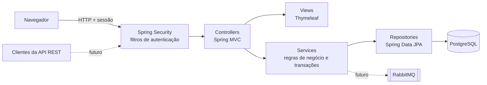
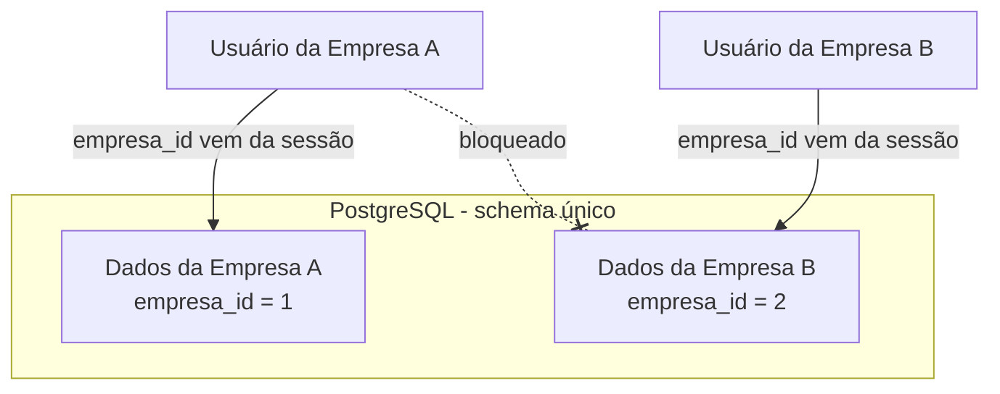

# Arquitetura

> Legenda: linhas contínuas = existente/planejado para a fase atual · linhas tracejadas = evolução futura

## Visão geral

## Responsabilidades das camadas

| Camada       | Responsabilidade                                                        | Não deve                                   |
|--------------|-------------------------------------------------------------------------|--------------------------------------------|
| Controller   | Receber a requisição, validar o formulário, escolher a view/redirect    | Conter regra de negócio ou abrir transação |
| Service      | Regras de negócio, orquestração e limites de transação                  | Conhecer HTTP, views ou sessão             |
| Repository   | Acesso a dados                                                          | Conter regra de negócio                    |
| View         | Exibir dados                                                            | Tomar decisões de negócio                  |

## Multi-tenancy

Cada assistência técnica (Empresa) é um *tenant*. O isolamento é feito por **coluna discriminadora** (`empresa_id`) nas tabelas de negócio.

**Regra de segurança:** o `empresa_id` usado nas consultas vem **sempre do usuário autenticado**, nunca da URL, do formulário ou do corpo da requisição. Ver [ADR-001](decisoes.md#adr-001--multi-tenancy-por-coluna-discriminadora).
