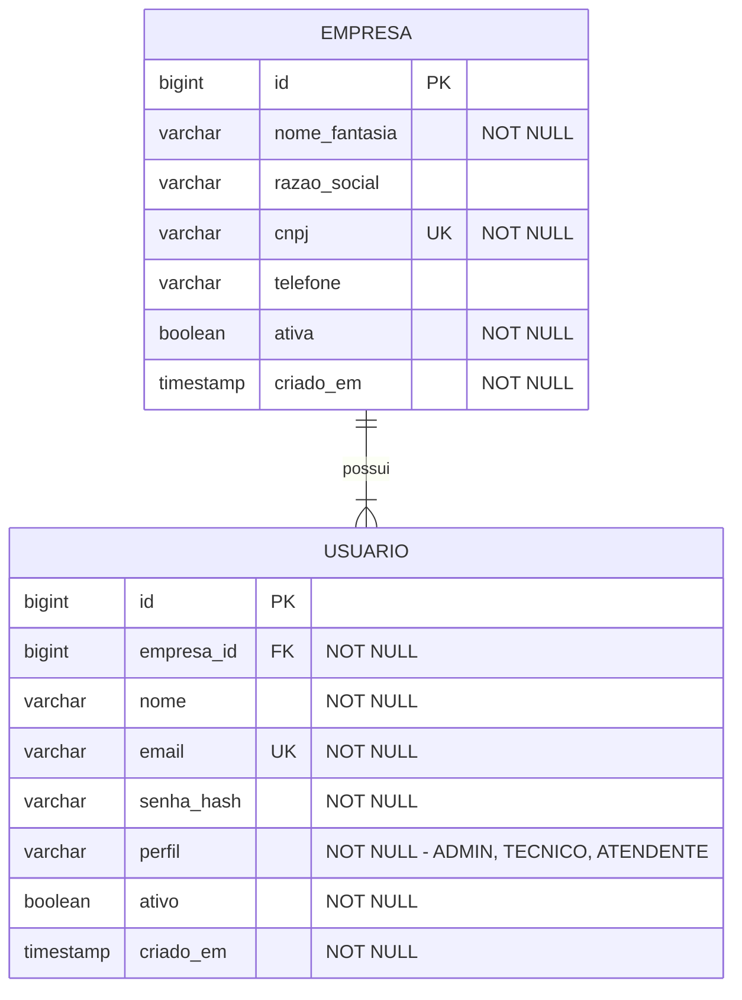

# Modelo de dados

> Status: 🟡 **planejado**. As tabelas ainda não foram criadas no banco.
> Atualize este diagrama sempre que o schema mudar.

## Diagrama entidade-relacionamento

## Regras de integridade

| Regra | Onde é garantida |
|-------|------------------|
| CNPJ único no sistema | `UNIQUE` no banco + validação no service |
| E-mail único no sistema (não por empresa) | `UNIQUE` no banco + validação no service |
| Toda empresa nasce com pelo menos um ADMIN | Transação do autocadastro |
| Todo usuário pertence a exatamente uma empresa | `empresa_id NOT NULL` + FK |
| Senha nunca armazenada em texto puro | Hash BCrypt no service |

Decisões relacionadas: [ADR-003](decisoes.md#adr-003--e-mail-único-global) e [ADR-004](decisoes.md#adr-004--dono-da-empresa-é-um-perfil-admin).
