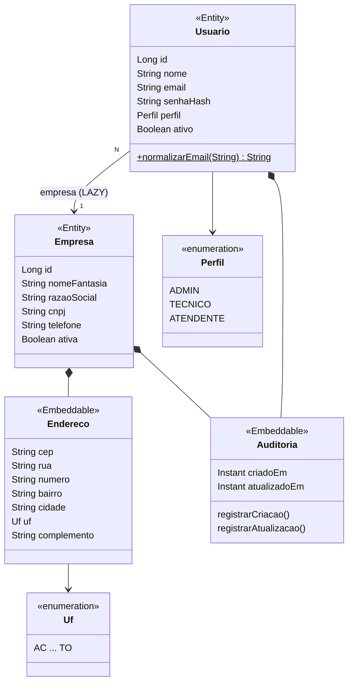

# Modelo de dados

> Status: ✅ **aplicado**. As tabelas existem no banco e as entidades JPA estão mapeadas.
> Atualize este diagrama sempre que uma nova migração alterar o schema.

## Diagrama entidade-relacionamento

## Mapeamento JPA

- `@Embeddable` não tem tabela própria: suas colunas ficam na tabela da entidade que o contém.
- `Auditoria` é preenchida por `@PrePersist` e `@PreUpdate`. Ver [ADR-007](decisoes.md#adr-007--auditoria-por-callbacks-do-ciclo-de-vida-jpa).

## Regras de integridade

| Regra | Onde é garantida |
|-------|------------------|
| CNPJ único no sistema | `UNIQUE` no banco + validação no service |
| CNPJ no formato alfanumérico (12 alfanuméricos + 2 dígitos verificadores) | `CHECK` com regex no banco + `@Pattern` na entidade |
| E-mail único no sistema (não por empresa) | `UNIQUE` no banco + validação no service |
| E-mail sempre em minúsculo e sem espaços nas pontas | Normalização na entidade `Usuario`. Ver [ADR-008](decisoes.md#adr-008--normalização-do-e-mail-na-entidade) |
| Perfil restrito a ADMIN, TECNICO, ATENDENTE | `CHECK` no banco + enum `Perfil` no Java |
| UF restrita às 27 siglas | Enum `Uf` no Java |
| Toda empresa nasce com pelo menos um ADMIN | Transação do autocadastro |
| Todo usuário pertence a exatamente uma empresa | `empresa_id NOT NULL` + FK |
| Empresa com usuários não pode ser apagada | FK sem `ON DELETE CASCADE` (desativar via `ativa`) |
| Data de criação nunca é alterada | `updatable = false` + preenchimento por `@PrePersist` |
| Senha nunca armazenada em texto puro | Hash BCrypt no service |

## Índices

| Índice | Motivo |
|--------|--------|
| `idx_usuario_empresa_id` | O PostgreSQL não indexa FKs automaticamente; consultas por empresa são as mais frequentes em um sistema multi-tenant |

## Histórico de migrações

| Versão | Script | Alteração |
|--------|--------|-----------|
| V1 | `V1__cria_empresa_usuario.sql` | Cria as tabelas `empresa` e `usuario` e o índice da FK |
| V2 | `V2__altera_coluna_uf_empresa.sql` | Altera `empresa.uf` de `CHAR(2)` para `VARCHAR(2)`: compatível com `@Enumerated(STRING)` e evita o preenchimento com espaços do `CHAR` |

Decisões relacionadas: [ADR-003](decisoes.md#adr-003--e-mail-único-global), [ADR-004](decisoes.md#adr-004--dono-da-empresa-é-um-perfil-admin), [ADR-005](decisoes.md#adr-005--tabelas-criadas-manualmente-sem-geração-pelo-hibernate) e [ADR-006](decisoes.md#adr-006--cnpj-alfanumérico-armazenado-sem-máscara).
