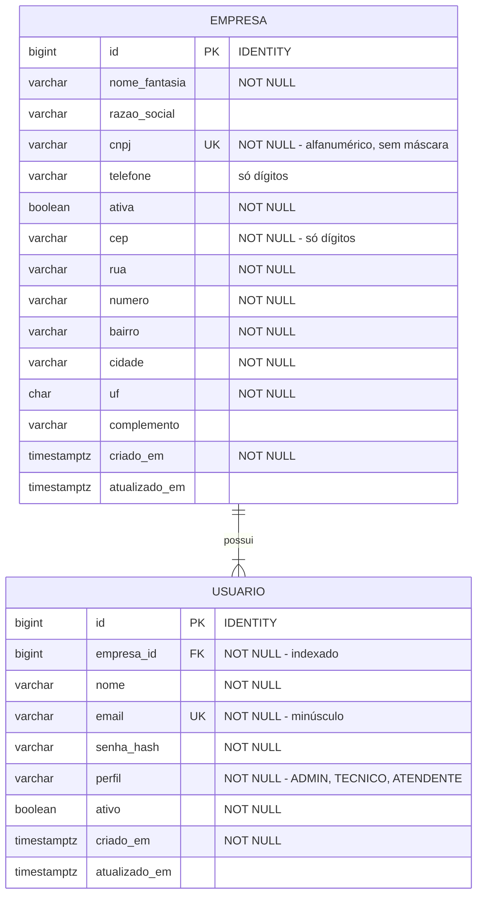

# Modelo de dados

> Status: ✅ **definido**. Schema em [`V1__cria_empresa_usuario.sql`](../src/main/resources/db/migration/V1__cria_empresa_usuario.sql).
> Atualize este diagrama sempre que uma nova migração alterar o schema.

## Diagrama entidade-relacionamento

## Regras de integridade

| Regra | Onde é garantida |
|-------|------------------|
| CNPJ único no sistema | `UNIQUE` no banco + validação no service |
| CNPJ no formato alfanumérico (12 alfanuméricos + 2 dígitos verificadores) | `CHECK` com regex no banco + validação na aplicação |
| E-mail único no sistema (não por empresa) | `UNIQUE` no banco + validação no service |
| E-mail sempre em minúsculo | Normalização na aplicação |
| Perfil restrito a ADMIN, TECNICO, ATENDENTE | `CHECK` no banco + enum no Java |
| Toda empresa nasce com pelo menos um ADMIN | Transação do autocadastro |
| Todo usuário pertence a exatamente uma empresa | `empresa_id NOT NULL` + FK |
| Empresa com usuários não pode ser apagada | FK sem `ON DELETE CASCADE` (desativar via `ativa`) |
| Senha nunca armazenada em texto puro | Hash BCrypt no service |

## Índices

| Índice | Motivo |
|--------|--------|
| `idx_usuario_empresa_id` | O PostgreSQL não indexa FKs automaticamente; consultas por empresa são as mais frequentes em um sistema multi-tenant |

Decisões relacionadas: [ADR-003](decisoes.md#adr-003--e-mail-único-global), [ADR-004](decisoes.md#adr-004--dono-da-empresa-é-um-perfil-admin), [ADR-005](decisoes.md#adr-005--tabelas-criadas-manualmente-sem-geração-pelo-hibernate) e [ADR-006](decisoes.md#adr-006--cnpj-alfanumérico-armazenado-sem-máscara).
